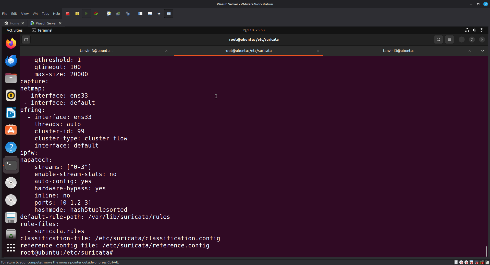
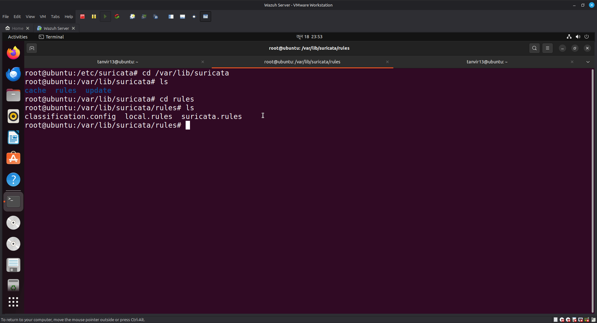
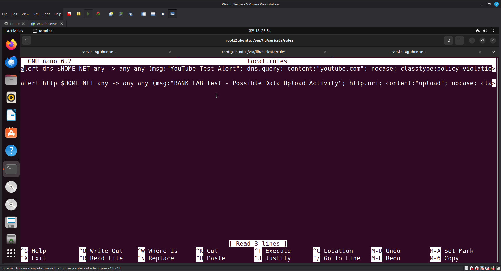
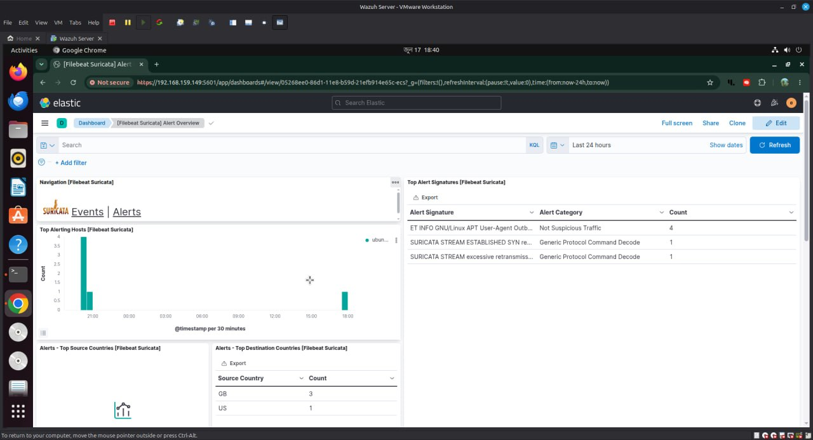
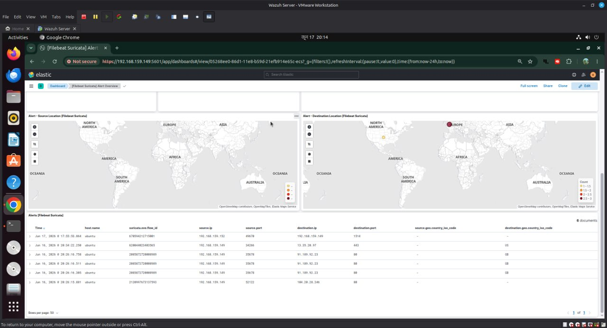
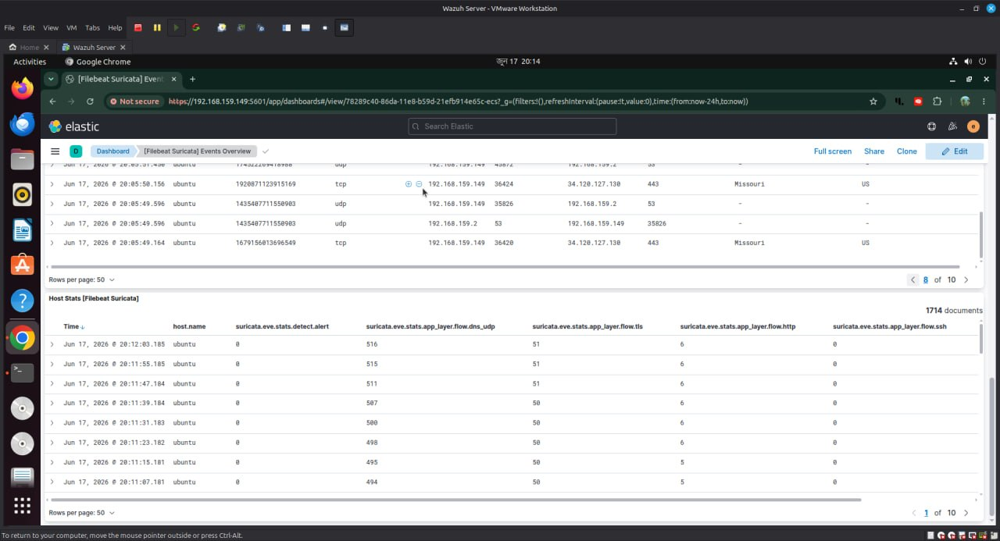

🚀 Automated SOC Components Setup Script
---

Overview

---


This script automates the setup of a comprehensive Network-based Intrusion Detection System (NIDS) and Host-based Intrusion Detection System (HIDS) on a single machine 

System Requirements

Before running the script, please ensure that your system meets the following requirements:

* Ubuntu OS

* * Minimum 6GB of RAM


---
Detecting Alerts in the network system by Suricata:
---


a) At first, I installed the the Wazuh server in . I went to the terminal & write it 

```bash
cd /etc/suricata
```

Then, I checked the suricata.yaml & write the above command in the terminal to see the suricata.rules

```bash
cat suricata.yaml
```



b) Here is the location of suricata rules

```bash
cd /var/lib/suricata
```



c) I type the alert rules by using nano in local.rules



Here, it is the rules in the local.rules

```bash

alert dns $HOME_NET any -> any any (msg:"YouTube Test Alert"; dns.query; content:"youtube.com"; nocase; classtype:policy-violation; sid:1000001; rev:1; metadata:created_at 2026_06_09, deployment Perimeter, confidence Low, signature_severity Minor, tag Test;)

alert http $HOME_NET any -> any any (msg:"BANK LAB Test - Possible Data Upload Activity"; http.uri; content:"upload"; nocase; classtype:policy-violation; sid:1000103; rev:1; metadata:banking_lab exfil_simulation;)

```

d) Then, I checked if there were any errors in the rules that I wrote local.rules

```bash
suricata -T -c /etc/suricata/suricata.yaml
```
e) Then I restart the suricata & check its status

```bash
systemctl restart suricata && systemctl status suricata
```

f) Then, I typed the above command in the terminal to see by which rules or signature suricata is trying to scan the network

```bash
grep -A 10 "rule-files" /etc/suricata/suricata.yaml
```
---







Here, we have to install the Wazuh server first. 

---
